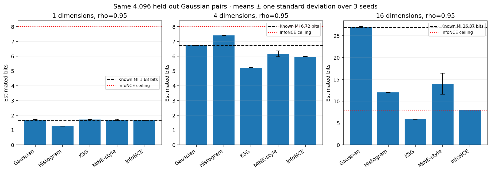

# Information, Compression & Communication Lab

A reproducible laboratory built from information-theory coursework: certified optimization, actual encoders and decoders, noisy communication, information estimation, and traditional/learned image compression. Theory is connected to concrete outputs and controlled comparisons, with configurations, numerical arrays, real bitstreams and independent checks.

[Open the interactive lab](docs/explorer.html) · [Measured results](docs/results.md) · [Executed notebooks](notebooks/README.md) · [Course coverage and proofs](docs/course_coverage.md)

GitHub's file viewer shows HTML source. To use the interactive lab, follow the local preview instructions below, or open the owner's GitHub Pages site after it is published.

<p></p>

The explorer starts with this photograph and its actual decoded reconstruction. Choose a field, source/scenario, method, parameter setting and seed. Its comparison tables use the applicable metrics for that task; every displayed row and image links to the same saved experiment. The page works offline and on GitHub Pages, without a training server or external JavaScript/CDN.

## What is implemented

| Field | Methods and concrete examples |
|---|---|
| Information algebra | Entropy, cross entropy, KL/JS, MI/CMI, chain rules, deterministic functions, parity synergy, conditioning, mixing, data processing and Fano. Corrected strictness counterexamples. |
| Sources and typicality | Stationary Markov entropy rates, subsampling/reordering/anchored sums, non-Markov witnesses, exact IID block-count simulations, weak versus strong typicality. |
| Lossless compression | Owned Huffman, Shannon, adaptive arithmetic orders 0/1 and explicit window LZ77; actual DEFLATE/Zstandard streams. Synthetic IID/Markov bytes, owned MIT source code and versioned E. coli sequence. |
| Capacity and allocation | Certified Blahut–Arimoto for BSC/BEC/Z/course/jammer channels, decoder side information, Gaussian water filling, explicitly labelled finite-length approximations. |
| Noisy channel coding | Uncoded/repetition baselines, Hamming hard/soft ML, terminated convolutional/soft Viterbi, owned short IRA-LDPC sum-product/normalized min-sum, Polar successive cancellation. Measured BER/BLER, actual code rates and message-level uncertainty. |
| Rate–distortion | Certified discrete BA, Bernoulli Hamming, forbidden asymmetric errors, four-PAM and a declared finite Gaussian discretization. Analytic and generic-solver checks. |
| Quantization and transmission | Training-only Lloyd–Max versus uniform scalar quantizers, actual coded indices/centers, Gaussian limits, matched-use/power digital ML/MAP/MMSE versus mean-centered analog transmission. |
| Rare events and testing | Exact binomial log probabilities, tilted importance sampling, method-of-types bounds, randomized Neyman–Pearson tests and finite-to-asymptotic Stein exponents. |
| Information estimation | Gaussian plug-in, sparse histograms and KSG across sample sizes/dimensions, checked against known Gaussian MI. Independent brute-force neighbor audit. |
| Neural estimators | Genuinely trained MINE-style DV and InfoNCE critics, disjoint training/validation/test draws, validation-selected checkpoints, portable safe NPZ model states and CPU inference checks. |
| Information bottleneck | Discrete self-consistent optimization, five local restarts, objective/residual diagnostics and relevance/compression tradeoffs. |
| Real image codecs | JPEG, WebP, AVIF, JPEG2000; official pretrained CompressAI factorized, scale-hyperprior, mean-scale-hyperprior and Cheng context/residual architectures. Actual entropy coding/decoding, container costs, RGB8 PSNR/SSIM/MS-SSIM and timing. |

The reference protocol has **569 configurations and 1,117 measured runs**, including **54 neural fits over three seeds**, **120 noisy-code experiments**, **96 actual image-codec comparisons**, and all theoretical/optimization cases. It includes **12 executed notebooks with 60 code cells**. Three L40S GPUs were used for the neural seed workers; image stream coding and independent portable inference were verified on CPU. Original course PDFs remain privately preserved and are excluded from Git and distributions.

## See the interactive results

From this repository directory, run:

```bash
python -m http.server 8005 --bind 127.0.0.1
```

Open **http://127.0.0.1:8005/**. The root automatically opens the explorer. In VS Code over SSH, open the **Ports** panel and use **Open in Browser** for port **8005**; forward that port if it is not listed. You can also open `docs/explorer.html` directly after downloading/cloning the repository locally.

The live binary-channel slider computes an exact formula; the photograph slider reveals original/decoded pixels. They are distinguished from the saved model experiments. Changing a model field selects another measured run, rather than pretending to retrain a model instantly in a browser.

## Run a small example

Python 3.10+ is supported. Use your own environment:

```bash
python -m venv .venv
source .venv/bin/activate
python -m pip install -e '.[dev]'
information-lab run --config configs/quick.json --output results/smoke
pytest
```

The core quick protocol uses bundled attributed compression fixtures and needs no dataset download, model checkpoint or GPU. For an installed wheel, `information-lab init my-configs` exports both protocol files. [Reproducibility](docs/reproducibility.md) gives the full commands, cache setup and independent audits.

For optional neural, image and notebook examples:

```bash
python -m pip install -e '.[dev,neural,images,notebooks,browser]'
export INFORMATION_LAB_DATA="$HOME/.cache/information-lab"
information-lab prepare --project-root . --data-root "$INFORMATION_LAB_DATA" --models
information-lab run --config configs/reference.json --output results/my-run \
  --data-root "$INFORMATION_LAB_DATA" --family neural --device cuda:0
```

Use `--family images --device cpu` for image codecs, or omit `--family` to run everything. The owner's large-file cache is `/data/navid.bagheri-shouraki/ML_data/information`; other users choose their own data root. Existing evidence is resumed only after matching configuration/source/input fingerprints and verifying saved artifact hashes.

## Findings worth inspecting

- **Finite digital coding does not automatically beat analog.** At 0 dB with seven channel uses per Gaussian source symbol, seed 41 gives analog MSE 0.37481, digital soft-ML MSE 3.84462, and prior-aware digital posterior-mean MSE 1.04249. Uses and expected power are matched.
- **A nearly perfect contrastive objective can severely underestimate MI.** With 16 dimensions and correlation 0.95, true Gaussian MI is 26.86763 bits, while batch-256 InfoNCE approaches its eight-bit ceiling. Gaussian and KSG baselines, MINE-style estimates, seed variation and checkpoint histories remain visible.
- **Zero naive hits do not mean zero probability.** Exact and importance-sampled rare-event log probabilities are compared, with Monte Carlo uncertainty and rigorous type bounds kept separate.
- **Real file overhead matters.** Prefix models can dominate small inputs; learned image likelihood bpp differs from the actual payload and complete container bpp. Four photographs reveal rate/quality tradeoffs alongside AVIF/WebP baselines.



[All six cross-method figures](docs/comparison_figures.json) have record-level source associations. [The comparison CSV](docs/comparison.csv) and [results JSON](docs/results.json) provide the complete scalar evidence.

## Evidence and limits

The runtime has **48 passing tests**, including exact capacities/rate–distortion answers, independent constrained-solver comparisons, exhaustive noisy decoder likelihoods, independent LDPC updates, actual codec round trips, source identities, neighbor-distance oracles and safe model export/inference. [Reference validation](docs/reference_validation.json) audits every configured run and saved stream. [Notebook validation](docs/notebook_validation.json) records all executed cells. [Browser validation](docs/browser_validation.json) records the full user-control and asset audit. [Release artifacts](docs/release_artifacts.json) record source/wheel checks.

Certified capacity and rate–distortion intervals, local IB solutions, finite stochastic estimates and measured codec performance have different meanings. They are documented in [mathematical and measurement contracts](docs/mathematical_contracts.md). Short owned LDPC/Polar examples are not 5G profiles. The Gaussian grid is not a continuous Gaussian source. Neural population bounds do not certify finite estimates. The four credited resized photographs are a demonstration set, with **no standard-benchmark or current SOTA claim**. Pretrained weights are official external inputs, not new training on these pictures.

Detailed reference arrays and streams are intentionally retained so figures can be checked; the source distribution includes this evidence, while the wheel contains the small runtime, configurations and fixtures. The supplied course materials include an incomplete class-specific LZ bitstream convention; the explicit implemented format and this limitation are documented rather than inventing an answer.

## Repository guide

- `src/information_lab/`: reusable scientific implementations and packaged defaults.
- `configs/`: explicit quick/reference protocols.
- `results/reference/`: measured records, safe arrays/models, actual streams and decoded images.
- `notebooks/`: executed lessons and controlled comparisons.
- `docs/`: readable guides, offline explorer, reports and validation receipts.
- `assets/`: attributed inputs, individual experiment figures and cross-method studies.
- `scripts/`: regeneration, independent audits and packaging checks.
- `legacy/manifest.json`: private course-material inventory and ownership boundary.

The project extends Cover–Thomas and the supplied Stanford/Wigger materials into practical experiments. [Course coverage](docs/course_coverage.md) maps every sheet problem to code or an original written argument, identifies incorrect blanket strictness claims, and states which textbook topics remain extensions.

## License and publishing

Original code and explanations are MIT licensed. [Sources and credits](docs/references.md) describe images, sequence/code fixtures, external model provenance and third-party ownership. Cite the software using [CITATION.cff](CITATION.cff).

This repository is prepared locally. Publishing remains a manual owner action. After uploading it to GitHub, enable Pages with **GitHub Actions** as the build source and manually run the included Pages workflow; it stages only public preview content. No local script pushes or deploys the repository.
